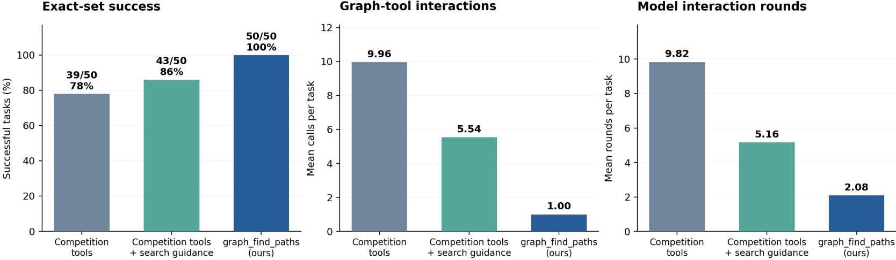

# You Only Search Once in Code Graph

Enumerate **all node-simple paths within a hop bound** between source and target symbols in your code graph. `graph_find_paths` supports **1–16 hops**, defaults to **4**, and returns shared node/edge tables with the full original attributes of every supporting edge row.

The Python API and CLI use only the standard library. Supply your own graph JSON; installation and queries need no Kaggle account, competition SDK, model service, or model weights. MCP is an optional transport.

## Gemma-4-31B results

In the supplied 50-question Gemma-4-31B experiment, `graph_find_paths` achieves **50/50 exact answers**, with **1.00 graph query** and **2.08 model rounds** per task. The competition tools achieve 39/50; adding search guidance raises that to 43/50.



See the [results and second figure](benchmark50/README.md#gemma-4-31b-results) and the [original prompts, tool selections and budgets](benchmark50/README.md#experiment-prompts-and-tool-configuration).

## Reproduce the 50-question study

The [benchmark50 guide](benchmark50/README.md) includes the fixed 50 questions, 142 reference paths, original competition-tool adapters, frozen prompts, isolated Python execution, a configurable model runner, and evidence-based grading. Its verified deterministic controls recover all 50 exact path sets: 6.46 mean graph queries with the competition tools plus a search program, and 1.00 with `graph_find_paths`.

Run the benchmark on your existing competition graphs, or fetch the exact files using its SHA-256 asset manifest. Model execution requires an explicit connection configuration and `--execute`.

## Quick start

From this project directory, with Python 3.9 or later:

```bash
python3 -m unittest discover -s variants/graph-find-paths -p 'test_*.py' -v
python3 run_graph_find_paths.py --graph example_graph.json \
  --sha256 92d0a209b67517b701256a3242f87b58016e83e7665f0e433c7c8f2c0cdc7d2f \
  --sources a --targets t --max-hops 4
```

The included graph has two branches. The adapter prints the complete packet and then:

```text
DECODED_PAIRS=[[["a", "b", "t"], ["a", "c", "d", "t"]]]
```

Both the 2-edge and 3-edge paths are returned. With `--max-hops 2`, only `a → b → t` is returned. In each case the result is complete within the requested bound.

## Install and use the CLI

```bash
python3 -m venv .venv
.venv/bin/python -m pip install .
.venv/bin/code-graph-find-paths --graph example_graph.json \
  query --source a --target t --max-hops 4
```

Add `--decode` to print the decoded node sequences instead of the full packet. Repeat `--source` or `--target` for multiple endpoints. `--sha256` is optional in this convenience CLI: omitting it pins the bytes of the supplied file; providing it checks against your expected asset digest.

```bash
.venv/bin/code-graph-find-paths --graph /absolute/path/my-graph.json \
  --max-paths 5000 --output-limit 100000 \
  query --source package.entry --target package.target --max-hops 16
```

The standalone `run_graph_find_paths.py` adapter and native factory require an explicit expected SHA256, matching the supplied reproduction protocol.

## Python API

```python
from code_graph_find_paths import GraphRuntime, decode_paths

with GraphRuntime("example_graph.json") as graph:
    packet = graph.query(source_nodes=["a"], target_nodes=["t"], max_hops=4)
    print(decode_paths(packet))
    print(packet["search_complete"], packet["output_complete"], packet["complete"])
```

The native factory and session are also available directly:

```python
from code_graph_find_paths import AllPathsSession, make_graph_find_paths

query = make_graph_find_paths(
    "example_graph.json",
    "92d0a209b67517b701256a3242f87b58016e83e7665f0e433c7c8f2c0cdc7d2f",
    max_paths=100000,
)
packet = query(source_nodes=["a"], target_nodes=["t"])  # default max_hops=4
```

The public native signature remains:

```python
graph_find_paths(source_nodes: list[str], target_nodes: list[str], max_hops: int = 4) -> dict
```

Native constructor/query validation raises `ValueError`; filesystem failures raise `OSError`. The Python wrapper preserves those errors. Its context manager releases the local session on exit.

## MCP integration

With Python 3.10+ for the optional MCP SDK:

```bash
.venv/bin/python -m pip install '.[mcp]'
```

Register this stdio configuration with your agent, using absolute paths:

```json
{
  "mcpServers": {
    "code-graph-find-paths": {
      "command": "/absolute/path/you-only-search-once-in-code-graph/.venv/bin/code-graph-find-paths",
      "args": ["--graph", "/absolute/path/my-graph.json", "serve"]
    }
  }
}
```

The server exposes exactly `graph_find_paths`, using the native name, description and parameters in `tool_schema.json`. A successful call delivers the complete default-serialized packet as MCP text content. Validation failures are transport errors (`isError=true`), rather than path results. Graph selection and budget overrides belong to host configuration. Each query gets fresh native work counters and budgets.

## Graph format

```json
{
  "nodes": [{"id": "a"}, {"id": "b"}, {"id": "t"}],
  "edges": [
    {"source": "a", "target": "b", "type": "calls", "file": "app.py"},
    {"source": "b", "target": "t", "type": "calls", "line": 12}
  ]
}
```

- Unique nonempty string node IDs, with every edge endpoint declared in `nodes`.
- Exactly one of `edges` or `links`; arbitrary extra attributes are retained in edge evidence.
- At most 16 MiB, 20,000 nodes and 100,000 edge rows; strict JSON parsing rejects duplicate object keys and non-finite numbers.
- One to three sources and one to eight targets. Exact IDs take precedence over unique suffix matches; ambiguous inputs stay unresolved.
- Traversal uses stored **undirected adjacency**. Reciprocal/parallel rows share one relation and retain all their original evidence without duplicating node sequences.
- Paths never repeat a node. A source equal to its target yields a zero-edge path. DFS follows lexical neighbor order; shorter and longer alternatives are both included within the bound.

Use a trusted expected hash when checking a graph against an external asset manifest. Sessions load an immutable snapshot; create a new session after updating the graph file.

## Budgets and completeness

| Host option | Default | Applies to |
|---|---:|---|
| `max_edge_rows` / `--max-edge-rows` | 2,000,000 | Original edge-row examinations per invocation |
| `max_dfs_states` / `--max-dfs-states` | 500,000 | DFS function entries per invocation |
| `max_paths` / `--max-paths` | 100,000 | Paths found across distinct ordered-pair searches |
| `output_limit` / `--output-limit` | 1,000,000 | Characters in `json.dumps(packet)` |

Search limits are nonnegative integers; output limit is an integer of at least 4096. Boolean values are rejected. All source/target pairs in one call share these budgets; repeated resolved ordered pairs reuse the same search. Reverse-direction pairs are distinct. Target-distance BFS prunes the DFS enumeration.

Each pair reports `found_count`, `returned_count`, `search_complete`, `output_complete`, and `complete`. The packet reports the same three completeness flags for the whole call. A returned path is supported even if more paths remain to be searched or delivered. Exhaustiveness requires `complete=true`. Truncation reasons identify the exhausted edge, DFS, path or output budget. A complete zero-result search has `status="no_path"`; interrupted searches remain `incomplete`, and unresolved endpoints remain `unresolved`.

## Decode the packet

`pairs` is a source-major grid. Each path's `nodes` indexes the shared `nodes` table, and its `edges` indexes the shared `edges` table. Each evidence entry preserves the original row index and full parsed row, including orientation and custom attributes.

```python
for pair in packet["pairs"]:
    for path in pair.get("paths", []):
        symbols = [packet["nodes"][i] for i in path["nodes"]]
        evidence = [packet["edges"][i]["rows"] for i in path["edges"]]
        print(symbols, evidence)
```

Use `pair.get("paths", [])`: output bounding may compact empty pair records and resolution metadata. Completeness flags describe the delivered result in every resolution mode.

## Project layout and verification

- `variants/graph-find-paths/`: path search tool, schema and twelve supplied tests.
- `exports/graph-find-paths/frozen/decision_lab/graph_native_v1/core.py`: exact pinned graph loader/resolver required by the tool.
- `run_graph_find_paths.py`, `example_graph.json`: supplied executable example.
- `code_graph_find_paths/`: installable Python API, CLI and optional MCP transport.
- `tests/`, `scripts/`: integration checks for the package and transport.

The tool implements the supplied all-paths search algorithm under the project’s current naming. The Python package verifies its bundled implementation automatically when loaded. The pinned loader provides graph loading and node resolution; the public callable comes from the path search tool.

```bash
python3 -m unittest discover -s variants/graph-find-paths -p 'test_*.py' -v
python3 -m unittest discover -s tests -v
# With the optional MCP extra installed:
python3 scripts/check_mcp.py
```
