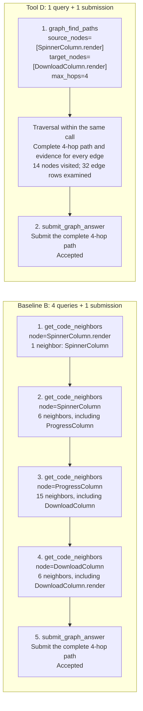

# Fast Path Search in Code Graph

Use **`graph_find_paths`** to find bounded paths in **your own code graph**, through Python, a command-line tool, or an MCP server. The default standalone runtime needs **no Kaggle account, competition SDK, model weights, Docker, or network access at query time**. Python/CLI have no third-party runtime dependencies; MCP is an optional extra.

The tool reads an existing JSON graph; it does not generate graphs from source code. It returns complete original edge-row evidence for stored **undirected adjacency**, not runtime execution direction or a guaranteed shortest path.

## Install and run a complete example

Python 3.12+ is required. This public repository can be cloned without GitHub authentication. Installation requires only ordinary Python packaging tools.

```bash
git clone https://github.com/ttoyekk1a/code-graph-find-paths.git
cd code-graph-find-paths
python3.12 -m venv .venv
.venv/bin/python -m pip install .
.venv/bin/code-graph-find-paths --graph examples/code-graph.json \
  query --source app.entry --target app.store
```

This is a complete copy-and-run example: no graph downloads, account credentials, or SHA placeholders. The result contains `matrix[0].state = "connected"` and the path `app.entry → app.service → app.store`. Its top-level status can be `partial`: the search stops after finding a complete witness, and does not exhaust the whole graph.

To install directly from Git:

```bash
python3 -m pip install 'git+https://github.com/ttoyekk1a/code-graph-find-paths.git'
```

The package is not published to PyPI; `pip install code-graph-find-paths` alone is not an installation route. On Windows, use the corresponding virtual environment `Scripts` executables; the generic runtime does not require bash (Windows has not been tested).

## Bring your own graph

Save this as `my-graph.json`, or supply the same structure from your graph exporter:

```json
{
  "nodes": [{"id": "app.entry"}, {"id": "app.service"}, {"id": "app.store"}],
  "edges": [
    {"source": "app.entry", "target": "app.service", "type": "calls"},
    {"source": "app.service", "target": "app.store", "type": "calls"}
  ]
}
```

```bash
code-graph-find-paths --graph my-graph.json \
  query --source app.entry --target app.store --max-hops 4
```

Requirements: unique, nonempty string node IDs; every edge endpoint declared in `nodes`; exactly one array named `edges` or `links`. Optional `key`/`type`, duplicate rows and reciprocal rows are retained as evidence. No sorting or rewriting of the graph file occurs. Loader limits: 16 MiB, 20,000 nodes, 100,000 edge rows. Directed graph metadata is accepted, but path traversal uses undirected adjacency.

`--sha256` is optional in standalone mode. Without it, the runtime computes and pins the supplied file's bytes; this does **not** claim trusted external provenance. To enforce a known asset, pass `--sha256 <trusted-hash>`; a mismatch fails. A session loads an immutable snapshot once: restart it after changing the graph file. Use one server process per graph.

## Python API

```python
from code_graph_find_paths import GraphRuntime

with GraphRuntime("my-graph.json", tool_calls=8) as graph:
    result = graph.query(
        source_nodes=["app.entry"],
        target_nodes=["app.store"],
        max_hops=4,
    )
    print(result["matrix"])
    print(result["paths"])
```

No SDK is imported and no workspace/container is created. The context manager closes the local session; using it after closure is rejected. You may pass `expected_graph_sha256="..."` to enforce provenance. `graph.schema` exposes the tool's model-facing declaration.

## Connect an agent through MCP

Install the optional transport:

```bash
.venv/bin/python -m pip install '.[mcp]'
```

Add a stdio server to your agent's MCP configuration, replacing only the executable and your graph file's absolute paths:

```json
{
  "mcpServers": {
    "code-graph-find-paths": {
      "command": "/absolute/path/code-graph-find-paths/.venv/bin/code-graph-find-paths",
      "args": ["--graph", "/absolute/path/my-graph.json", "serve"]
    }
  }
}
```

The host may need to reload its MCP configuration. It will discover exactly **`graph_find_paths`**. Example tool arguments:

```json
{"source_nodes": ["app.entry"], "target_nodes": ["app.store"], "max_hops": 4}
```

Graph path/hash are host configuration, not model parameters. MCP delivers the entire result as default-serialized JSON text, without a second truncation pass. The default allowance is **8 attempts per session**, including invalid/unknown requests; set `--tool-calls 100` before `serve` for a longer agent session. Exhaustion requires an explicit new session or a larger configured allowance, not hidden retries. Controller errors have `scope: controller`; query evidence retains the original format, including legacy `mode: C` and local `native` budget counters. No SDK attestation is implied by those fields.

## Search guarantees and limits

- One to three sources and one to eight targets; exact IDs or unambiguous suffixes.
- 1–4 hops, 160 visited nodes and 800 encountered original edge rows **for the whole query**, not per endpoint pair.
- Single resolved source/target uses bidirectional search; other allowed shapes retain the radius fallback.
- Core/public limits remain 6000/8000 default-JSON characters. Only complete paths are retained.
- `partial` can contain usable `connected` paths. `unknown`, omitted evidence or exhausted budgets do not prove disconnection.
- Source/runtime grounding and automatic source-code graph generation are outside scope.

## Tests without competition dependencies

After installing from this checkout:

```bash
.venv/bin/python -m unittest discover -s tests -p 'test_standalone.py' -v
# With the optional [mcp] extra installed:
.venv/bin/python scripts/standalone_mcp_smoke.py
```

These checks use synthetic user graphs, not downloaded competition assets. The original frozen contract tests also need only the standard library:

```bash
python3 -I -B graph-find-paths/scripts/verify.py
```

## Optional competition reproduction

The frozen search implementation, schema and 18 historical replay fixtures in `graph-find-paths/`, plus `datasets/original32/`, are preserved. Internal transfer documents are excluded from the distribution; the manifest describes the retained files. The standalone engine is an explicitly documented adaptation; see [source provenance](code_graph_find_paths/_engine/PROVENANCE.json). It does not impersonate or inject `swegemma` modules.

### Example: neighbor-by-neighbor exploration vs. one path query

The reported `followup-001` example connects `SpinnerColumn.render` to `DownloadColumn.render` in Rich. Node IDs below omit the `rich.progress.` prefix for readability.



This example reduces agent query calls from four to one; the graph traversal still happens inside the tool. The [D replay fixture](graph-find-paths/fixtures/real-graph-replays.json) records the complete path and the 14-node/32-edge-row counters. The B sequence and submission outcomes summarize the reported comparison; their full model traces are not included in this repository. These counts describe this case, not a guaranteed speedup or SWE repair improvement. `submit_graph_answer` is a benchmark submission interface, not a tool exposed by the standalone MCP server.

### Run the competition backend

**Only** this optional backend requires authorized Kaggle access and the official SDK. Install it with the existing script:

```bash
bash scripts/setup_runtime.sh
.venv-runtime/bin/code-graph-find-paths \
  --backend competition --graph /absolute/path/original-graph.json \
  --sha256 '<trusted-original-sha256>' \
  query --source rich.progress.SpinnerColumn.render \
        --target rich.progress.DownloadColumn.render
```

The Python equivalent is `CompetitionRuntime(graph_path, expected_graph_sha256)`. This explicitly selects the existing official SDK context, budget gate and owned subprocess workspace. For old MCP configurations that require the SDK backend, add `--backend competition` before `serve`; version 0.2 defaults to standalone. Installing only the skill instructions does not install an executable tool.

For historical replay and real SDK checks (from the repository root):

```bash
python3 scripts/fetch_graphs.py
python3 -I -B graph-find-paths/scripts/verify.py --graphs-dir data/graphs
.venv-runtime/bin/python -I -B scripts/runtime_smoke.py
.venv-runtime/bin/python -m unittest discover -s tests -p 'test_runtime.py' -v
.venv-runtime/bin/python scripts/mcp_smoke.py
```

The [Actions template](.github/verify-workflow.yml.example) is provided for automated checks. It remains a template because the publishing credential lacks workflow-write permission.

## Fixed path-question datasets

The repository contains **50 fixed path questions** in two separate cohorts. They preserve their original IDs and order and serve different evaluation purposes:

| Cohort | Questions / original tasks | Shortest distances | Materials | Historical local experiment |
|---|---:|---|---|---|
| `original32` | 32 / 32 | 8 each at 1, 2, 3 and 4 hops | [Questions, asset mappings, private reference answers and frozen configuration](datasets/original32/) | B/C/D/E/F × 2 repeats = 320 runs |
| `followup18` | 18 / 18 | 16 at 4 hops, 1 at 1 hop, 1 at 2 hops | [Existing historical D tool-output replay fixtures](graph-find-paths/fixtures/real-graph-replays.json) | B/D × 2 repeats = 72 runs |

The 32 new questions cover Rich (15), FastAPI (15) and Requests (2). Together the cohorts contain 50 distinct original tasks and 50 distinct unordered endpoint pairs, **not 50 independent code families**; near-duplicate graph families remain a limitation. Question counts and repeated experiment runs are different quantities. Public `max_hops` is always **4**, including questions whose shortest reference distance is smaller.

From the repository root, download/verify the two cohorts' original graph assets and validate the combined dataset:

```bash
python3 datasets/original32/fetch_graphs.py --dest data/graphs
python3 scripts/fetch_graphs.py
python3 -I -B datasets/original32/verify.py \
  --graphs-dir data/graphs \
  --followup-fixtures graph-find-paths/fixtures/real-graph-replays.json
```

Use an existing original-graph directory with `--graphs-dir` to avoid downloading. With only the 32 original assets available, omit `--followup-fixtures`; that validates only `original32`, not all 50 questions. Missing, ambiguous or hash-mismatched graph files fail verification and must not be regenerated or substituted.

This check validates **data, asset mappings, shortest distances, reference paths and cohort disjointness**. It makes zero tool calls and zero model requests. It is neither a 32-question historical tool-output replay nor a model success-rate evaluation. The original 18 replay fixtures remain separate and unchanged. The local result is recorded in [the combined dataset verification report](evidence/original32-verification.json).

`questions.jsonl` is host input: pass only `query_id`, `start`, `target`, `max_hops` to a solver. Asset filenames/hashes are host configuration. Keep `answers.private.jsonl`, `provenance.private.jsonl`, `family-strata.jsonl`, reference paths and historical `expected` tool outputs evaluator-only. For `followup18` model input, project only `query_id` and `arguments.source_nodes[0]`, `arguments.target_nodes[0]`, `arguments.max_hops`; never pass `expected`.

Reference paths establish solvability and shortest distance; other valid paths may also pass. A future model evaluator must verify that every submitted edge was actually delivered by a tool in that attempt, rather than compare the path string with the reference answer. The supplied dataset validator does not implement that trace-based grading.

The current package implements D only. Dataset import does not add all B/C/E/F experimental backends or establish new model results. Historical `original32` used Chat Completions, whereas the complete `followup18` batch used stateless asynchronous Responses; their elapsed times must not be combined as one same-protocol batch. Any new model/service comparison must be separately labeled and preserve cohort-level reporting.

## What a receiving agent should verify

1. The host exposes exactly `graph_find_paths`, with the frozen schema in [`tool-schema.json`](graph-find-paths/references/tool-schema.json).
2. A valid query consumes one native tool call, performs at most one core search, and delivers the entire result unchanged.
3. Invalid/unknown calls are counted by its outer controller, exhausted budgets are rejected, and shutdown closes the owned session/workspace.
4. For competition reproduction its graph SHA matches the task asset; for real SWE work, separately check source snapshot/base-commit alignment.
5. If testing model performance, use the frozen benchmark system/schema and keep all acceptance fixtures out of solver context.

## Evidence and boundaries

[Standalone verification](evidence/standalone-summary.json) records a clean installed wheel running Python/CLI without third-party runtime dependencies and MCP with only its optional transport dependencies, with no Kaggle or competition SDK installed. Fourteen standalone tests passed; the optional SDK retained all five integration tests, and the unchanged frozen verifier passed 41 tests plus 18 original-graph replays. The standalone engine also matched all 18 reference packets after excluding dynamic timing/length and its deliberately different host-audit label.

[`evidence/verification.json`](evidence/verification.json) records the 41 tests and 18 replays. [`evidence/runtime-summary.json`](evidence/runtime-summary.json) records the actual official `SwegemmaContext`, `SubprocessManager` and `ToolRegistry` check: exact name/schema, one-call budget increment, full edge-row evidence, budget/session rejection and workspace cleanup. In that optional backend, the SDK budget module matches the frozen SHA256. [MCP evidence](evidence/mcp-summary.json) verifies real client discovery, calls, attempt limits and disconnect cleanup. [Package evidence](evidence/package-summary.json) verifies the built wheel works outside the checkout. The source-provenance record identifies original implementation hashes and documents the equivalent Unicode-escape normalization in a test file.

The historical competition runtime smoke loaded no source snapshot and sent no model requests. Docker execution, graph-to-live-source alignment, end-to-end SWE repair and model gains remain unverified. Both runtimes are graph-tool hosts, not complete competition task environments. Native SDK model-serving extras are intentionally absent.

A top-level `partial` may contain a valid `matrix.connected` and a complete path. `unknown` or budget exhaustion is not proof of no path. Paths witness **stored undirected adjacency**, not shortest paths or runtime call direction. The legacy output `mode: C` is intentional. Limits remain 1–4 hops, 160 visited nodes, 800 encountered original edge rows, and 6000/8000 default-JSON characters for core/public output.

The competition uses a closed tool registry and declarative submissions: publishing this package does not add a custom tool to Kaggle's scoring host. No Kaggle submission has been made.

## Layout

- [`graph-find-paths/`](graph-find-paths/): hash-pinned implementation, schema, skill and historical fixtures.
- [`datasets/original32/`](datasets/original32/): byte-pinned original 32 questions, asset mappings, evaluator-only reference answers and data validation scripts.
- [`code_graph_find_paths/`](code_graph_find_paths/): installable host adapter, CLI and MCP transport.
- [`scripts/`](scripts/): setup, data download and runtime smoke.
- [`evidence/`](evidence/): portable verification summaries; raw local paths/logs are excluded.

Graph files, SDK wheels, local environments and raw runtime records are excluded from Git. Internal transfer documents and attachment-recovery utilities are excluded from the distribution. No new license grant is asserted for the supplied frozen sources or official SDK.

Data: [Kaggle competition](https://www.kaggle.com/competitions/gemma-4-developer-agent/data). SDK: [official wheelhouse](https://www.kaggle.com/datasets/metric/gemma-4-developer-agent-wheelhouse).
