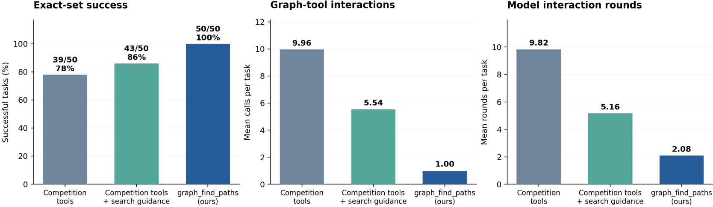
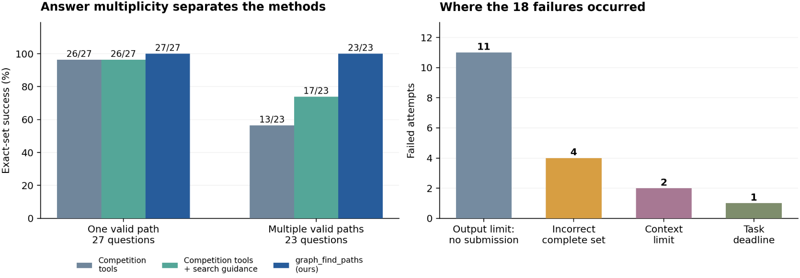

# 50-question code-graph benchmark

Reproduce the fixed 50-question path-search study with 50 original graph files and 142 reference paths: Rich 25, FastAPI 23 and Requests 2. Every question asks for all node-simple paths of at most four edges in the stored undirected graph. Question IDs, endpoints and source cohorts are preserved.

The three model configurations are **Competition tools**, **Competition tools + search guidance**, and **graph_find_paths**. Each also exposes `execute_python` and `submit_graph_answer`. A full model campaign has 150 episodes, one per question and configuration.

## Gemma-4-31B results

The supplied Gemma-4-31B experiment evaluates 50 tasks per configuration. The selected historical outcomes are preserved in [historical/tasks.csv](historical/tasks.csv).



*Figure 1. Exact-set success and mean interaction costs across all 50 tasks, including unsuccessful attempts. Graph queries exclude Python and final submission.*

| Configuration | Exact answers | Mean path recall | Graph queries/task | Python calls/task | Model rounds/task | Mean tokens/task |
|---|---:|---:|---:|---:|---:|---:|
| Competition tools | 39/50 (78%) | 80.42% | 9.96 | 0.98 | 9.82 | ≥80,695 |
| Competition tools + search guidance | 43/50 (86%) | 87.00% | 5.54 | 1.28 | 5.16 | 34,798 |
| `graph_find_paths` (ours) | **50/50 (100%)** | **100%** | **1.00** | **0.08** | **2.08** | **4,874** |

*Tokens include input and output across all rounds, including repeated history. The competition-tools total is a lower bound because some usage records are missing; missing usage remains unknown.*

`graph_find_paths` achieves 100% exact-set success, improving on the two comparators by **22** and **14 percentage points**. It uses one graph query per task and 2.08 model rounds on average.



*Figure 2. Exact-set success by answer multiplicity, and terminal failure categories for the 18 unsuccessful comparator attempts.*

On the 23 questions with multiple valid paths, the three configurations solve **13, 17, and 23**, respectively. On the 27 single-path questions, they solve **26, 26, and 27**.

## Experiment prompts and tool configuration

The original Gemma experiment's prompt, tool choices and budgets are included:

| File | Purpose |
|---|---|
| [system-prompt.txt](config/system-prompt.txt) | Shared system prompt: path-enumeration objective, evidence requirements, budgets, Python usage and submission format. |
| [search-guidance.md](config/search-guidance.md) | Extra search guidance appended only for the guided competition-tools configuration. |
| [study.json](config/study.json) | Per-configuration graph-tool selection, guidance flags, sampling settings and execution budgets. |
| [tools.json](config/tools.json) | Frozen model-visible tool descriptions and JSON schemas, including the experimental four-hop limit. |
| [connection.example.json](config/connection.example.json) | Provider URL, served model name, API-key environment variable and transport selection. |

| Configuration | Available graph tools | Additional system text |
|---|---|---|
| Competition tools | `get_code_neighbors`, `get_code_subgraph` | None |
| Competition tools + search guidance | `get_code_neighbors`, `get_code_subgraph` | `search-guidance.md` |
| `graph_find_paths` | `graph_find_paths` | None |

All three configurations also receive `execute_python` and `submit_graph_answer`. The guided configuration appends exactly two newlines and the guidance text to the shared system prompt. The runner exposes only that configuration's selected tools. Each user message contains only `query_id`, `start`, `target` and `max_hops`.

Shared settings are temperature **0.2**, maximum output tokens **4096**, **32** graph attempts, **16** Python attempts, **1** submission, **64** model rounds and **600 seconds** per task. See [Configure and run a model](#configure-and-run-a-model) to connect a served Gemma model or another compatible model.

## Install

Use Python 3.12 and a working Docker Engine/CLI for the benchmark. The product API and CLI continue to work without benchmark dependencies.

```bash
python3.12 -m venv .venv-benchmark
. .venv-benchmark/bin/activate
python -m pip install -r benchmark50/requirements.txt
python -m pip install --no-deps .
```

`requirements.txt` locks the dependency versions validated for this portable implementation. The optional `pip install '.[benchmark]'` installs the five direct dependencies; the requirements file additionally pins their transitive dependencies.

## Obtain the graphs

Graph assets come from the [Gemma 4 developer-agent competition](https://www.kaggle.com/competitions/gemma-4-developer-agent). The checked-in `data/graph-assets.json` identifies each competition file, its exact byte count and SHA-256. Total size is 165,369,567 bytes.

If you already have the competition's original `graphs/` directory, pass that directory directly. Otherwise install the Kaggle CLI in a separate environment, configure your own Kaggle access, and run:

```bash
python -m benchmark50.scripts.fetch_graphs --graph-dir benchmark50/graphs
python -m benchmark50.scripts.verify_dataset --graph-dir benchmark50/graphs
```

The downloader skips verified existing files and rejects mismatches. It preserves downloaded JSON bytes. Graphs are excluded from Git and the Python distribution; they are supplied through the fixed competition filenames and hashes. An actual Kaggle download and hash check were exercised during validation, and all 50 existing raw graph assets passed verification.

`verify_dataset` also uses the supplied independent meet-in-the-middle oracle to regenerate every reference path, check uniqueness, and verify the 50/142 counts. Model-visible questions contain exactly `query_id`, `start`, `target`, and `max_hops`; graph paths and reference answers stay in the host evaluator.

## Run the deterministic controls

```bash
python -m benchmark50.scripts.run --mode deterministic \
  --graph-dir benchmark50/graphs --run-name offline-01
python -m benchmark50.scripts.compare_product --graph-dir benchmark50/graphs
python -m benchmark50.scripts.run --check --graph-dir benchmark50/graphs
```

Each new run name creates a new directory under `runs/`. `--runs-dir` can select an absolute output directory. Existing runs are never overwritten. These commands send zero model requests.

The executed controls reproduced:

| Deterministic configuration | Exact sets | Mean graph attempts | Certified complete |
|---|---:|---:|---:|
| Competition tools + deterministic program | 50/50 | 6.46 | 49/50 |
| graph_find_paths direct | 50/50 | 1.00 | 50/50 |

Both recovered all 142 paths. The deterministic controller is kept separate from the model configurations. The guidance group receives the original guidance text, with no injected solver program.

## Build and verify isolated Python

The Dockerfile pins an official multi-architecture Python base digest and installs no packages for agent code. Each call runs a fresh standard-library Python process, without network or host mounts, as UID 65534 with a read-only root, no capabilities, 128 MiB memory, one CPU, 32 PIDs and a 16 MiB temporary filesystem. Calls have at most ten seconds including cleanup, bounded by the episode's remaining time.

```bash
docker build -t code-graph-benchmark-python - < benchmark50/Dockerfile.python
GRAPH_PYTHON_IMAGE=$(docker image inspect code-graph-benchmark-python --format '{{.Id}}')
python -m benchmark50.scripts.run --check --graph-dir benchmark50/graphs \
  --python-image "$GRAPH_PYTHON_IMAGE"
python -m benchmark50.scripts.smoke --graph-dir benchmark50/graphs \
  --python-image "$GRAPH_PYTHON_IMAGE" --run-name smoke-01
python -m benchmark50.scripts.evaluate --run runs/smoke-01
python -m benchmark50.scripts.aggregate --run runs/smoke-01
```

For a non-default Docker daemon, export `DOCKER_HOST` before these commands or pass `--docker-host` to the runner. The old image ID in frozen `config/study.json` is historical metadata; execution requires your locally built `--python-image`. The campaign records that image ID, Python version, and the isolation preflight result.

`smoke` runs three fresh worker processes against a scripted HTTP transport and real Python containers. It checks exact first-request system text, questions and tool schemas, retained conversation history, evidence-only Python input, and accepted submission. It makes zero real model requests. Saved smoke reports are marked `mock` and `partial`, with 3 of 150 task slots exercised.

## Configure and run a model

Copy `config/connection.example.json` to `connection.local.json`, set `enabled` to `true`, and provide the provider's Chat Completions base URL and exact served model name. Store credentials only in the environment variable named by `api_key_env`. Local connection files and run directories are ignored by Git.

The transport supports OpenRouter and other OpenAI-compatible, nonstreaming Chat Completions endpoints. All three groups use the same model, temperature 0.2 and output-token budget 4096. The full request body, response, tool results, counters and request status are recorded per round; authentication headers are not recorded. Generation requests are never automatically retried.

The frozen `study.json` field `model_enabled:false` records the historical preparation state; the portable launcher uses explicit `--execute` plus the connection’s `enabled:true` gate.

Once your connection and environment are configured, launch explicitly:

```bash
python -m benchmark50.scripts.run --execute --graph-dir benchmark50/graphs \
  --connection connection.local.json --workers 3 --run-name model-01 \
  --python-image "$GRAPH_PYTHON_IMAGE"
python -m benchmark50.scripts.evaluate --run runs/model-01
python -m benchmark50.scripts.aggregate --run runs/model-01
```

The model-launch command is provided for the recipient; no real model campaign was executed during this implementation. The dataset, deterministic, container, mock-transport and installed-package commands were executed.

Three worker slots are shared across configurations. Each episode runs serially in its own process; a free slot takes the next task. At most `--workers` tasks are in flight. A cleanup failure stops new launches. Budgets are fixed at 32 graph attempts, 16 Python attempts, one submission, 64 model rounds and 600 seconds per episode. Invalid arguments consume attempts. A submitted answer terminates the episode and suppresses later calls in the same response. No history compression or answer repair is applied.

Use the same command with `--resume` to launch only never-claimed tasks. Resume first checks frozen input hashes, model/config identity and saved task identities. Finished failures are retained. A claimed task that lacks a result is retained as incomplete and is never automatically retried. Reports stay `partial` until all 150 terminal results exist. Worker errors with uncertain request counts are identified separately from known requests.

## Historical versus product implementation

By default, the benchmark uses the frozen historical candidate and its original packet identifier, plus the frozen experimental tool schema whose maximum is four hops. `--implementation product` explicitly selects the current installable tool while keeping the same four-hop experimental schema. This choice is recorded in every run.

The product still supports 1–16 hops outside the benchmark. All 50 product packets at default four hops and explicit four hops were compared with the historical candidate: every field and original edge-evidence row matched, except the version identifier.

Competition retrieval uses the original SDK modules and `NativeBaseline` adapter on a preloaded graph. `get_code_neighbors` queries one node; `get_code_subgraph` retrieves edges among the supplied nodes. The adapter preserves the original retrieval code and avoids unrelated embedding initialization.

## Grading and reports

Exact-set success requires an accepted formal submission with valid canonical IDs, ordered endpoints, no repeated nodes or duplicate paths, at most four edges, and exactly the reference path set. Every submitted edge must be supported by a graph-tool result actually delivered to the model. The evaluator never repairs submitted IDs.

`complete=false` can still pass exact-set success. `certified_success` additionally requires a true completeness claim backed by a recognized certificate. An incorrect complete claim and an unrecognized proof for an otherwise exact set are reported separately.

`aggregate` writes `summary.json` and a 150-row `tasks.csv`. Success always uses 50 planned questions per configuration. Means include both successes and failures; partial reports identify their observed denominator and missing tasks. Token fields contain known totals/means plus explicit unknown-usage counts and a completeness flag.

The [Gemma-4-31B results](#gemma-4-31b-results) above are supplied historical outcomes. New reports are computed from saved episodes. The CSV's relative `evaluated_path` values identify historical sources; the historical network logs are not bundled.

## Source integrity and tests

`HANDOFF_MANIFEST.json` records the supplied file hashes. Original source, schemas and configuration are retained under `reference-source/`; formal entry points live under `benchmark50`. `MANIFEST.json` also checks the portable implementation. Original reference scripts are archival material and are not launch entry points.

Chat Completions is the default transport. Providers that implement background Responses can opt into `"protocol": "responses_background_stateless"`. The optional adapter uses the frozen, hash-checked codec, creates each generation once, and polls the same response ID. It retains ownership and cleanup state on failures. A campaign uses the selected protocol for all three groups and records it; there is no automatic protocol switch. Original hybrid transport and scheduler sources remain in the reference archive.

```bash
BENCHMARK50_GRAPHS_DIR="$PWD/benchmark50/graphs" \
BENCHMARK50_TEST_DOCKER=1 \
BENCHMARK50_TEST_IMAGE="$GRAPH_PYTHON_IMAGE" \
python -m unittest discover -s benchmark50/tests -v
python -m unittest discover -s variants/graph-find-paths -p 'test_*.py' -v
python -m unittest discover -s tests -v
```

Docker tests also accept `BENCHMARK50_DOCKER_HOST`. Installed-package checks were run from a temporary working directory outside the checkout, with absolute graph and output paths. See `validation.json` for the executed validation summary.
